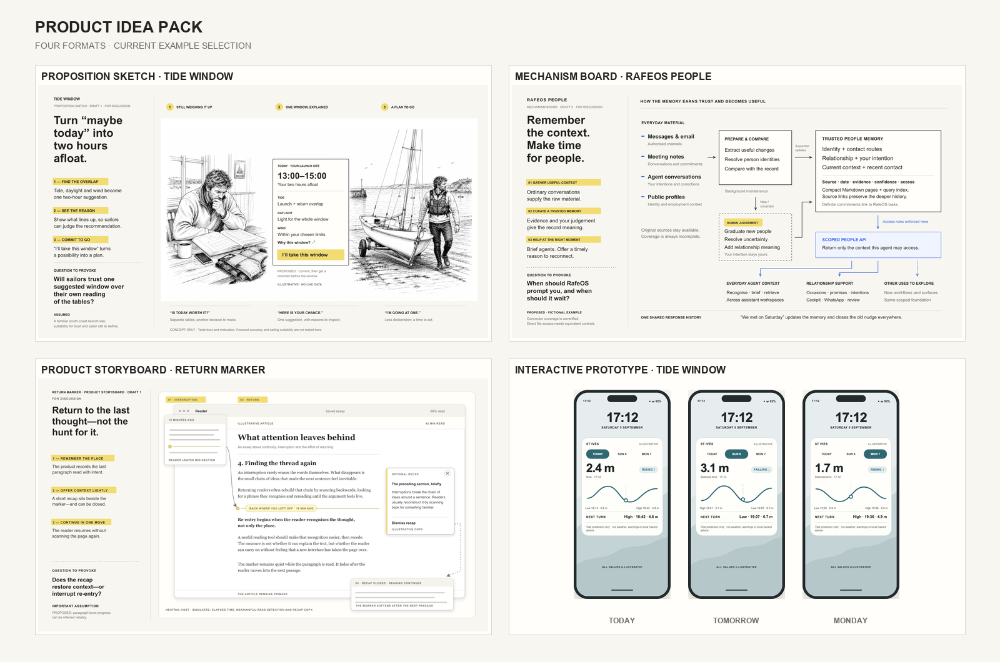
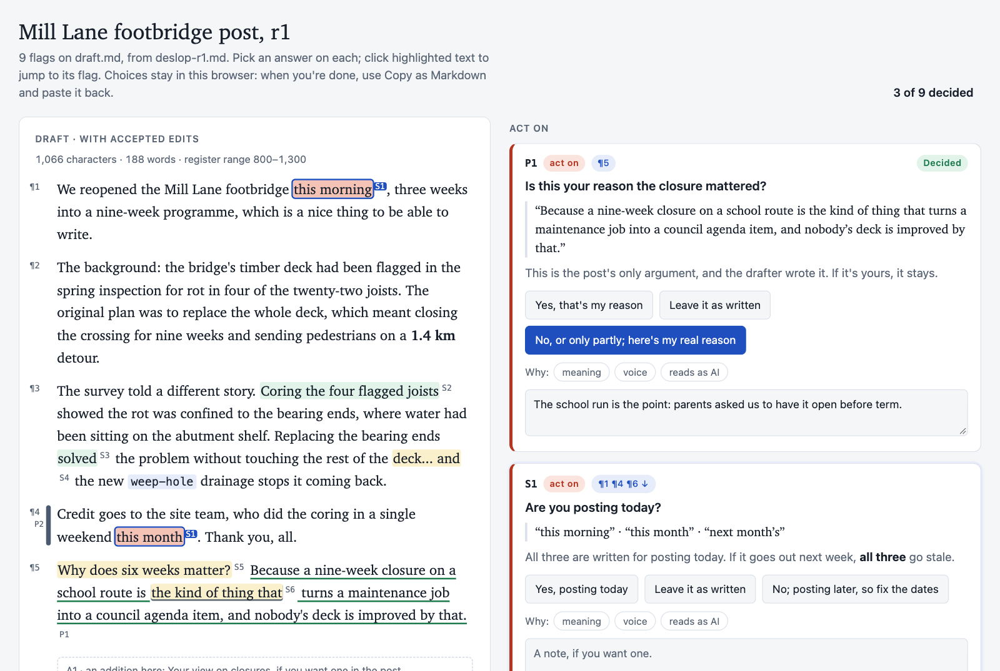
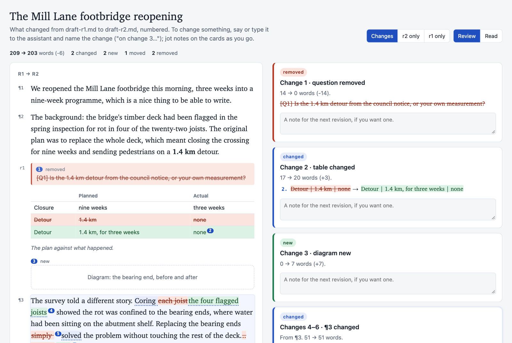

# Rafe Blandford’s Agent Skills

Reusable workflows I have built and found useful for extending AI agents. They
are published for other people to use, adapt and learn from.

Each skill is a self-contained folder built in the open [Agent Skills][spec]
format, combining a `SKILL.md` with any supporting references, assets, templates
and helper scripts it needs.

## Featured

### Product Idea Pack

**[`product-idea-pack`](skills/product-idea-pack/)** turns an early
digital-product idea into a proposition sketch, mechanism board, product
storyboard or interactive HTML prototype before anyone commits to polished UI.

[](examples/product-idea-pack/)

It supports three natural starting points: discuss an idea first and invoke the
skill later, provide a structured brief, or ask it to guide a rough thought with
one useful question. Better inputs and purposeful references provide more
control; thin prompts deliberately leave more for the agent to infer.

The lead [RafeOS People case study](examples/product-idea-pack/rafeos-people/)
shows the full conversation-led workflow: an exploratory discussion, structured
brief, three formats, two human-feedback rounds, five final concept boards and
an editable Figma hand-off. In the release tests, a typical generation or
revision turn took roughly 15–20 minutes. That speed gets an idea to a useful
discussion object; the output still needs human judgement and audience-specific
refinement.

[Install in ChatGPT](https://chatgpt.com/plugins/plugins_6a9f044052ec8191837959ef4df3dc9e) ·
[Read the website guide](https://rafeblandford.com/product-idea-pack/) ·
[Read the launch article](https://rafeblandford.com/making-product-ideas-visible/) ·
[Read the standalone documentation](skills/product-idea-pack/README.md) ·
[See the examples](examples/product-idea-pack/) ·
[Download Product Idea Pack v0.1.2](https://github.com/rafeblandford/skills/releases/tag/product-idea-pack-v0.1.2)

### Writing in your own voice

**[`voice`](skills/voice/)** drafts writing that goes out under your name, from
your dictation, notes or brief, keeping the argument yours: where a step in the
reasoning is missing, it asks rather than inventing one.
**[`deslop`](skills/deslop/)** reviews a draft before it goes out, flagging what
isn't yours and what readers are likely to take as AI, and leaves every
decision to you. Both set their depth by how much the piece matters.

[](examples/deslop/)
[](examples/voice/)

Everything about the writer lives in a separate voice pack; each skill ships
with a fictional example pack to show the shape. **Build your own pack before relying on either skill:** until you do,
both say they are working without one.
[The guide to building your own](skills/voice/references/pack/README.md)
explains how, and how to point the skills at it. Each
also turns its output into one self-contained page to review: `deslop` puts its
flags beside the draft for you to decide, and `voice` shows where each
paragraph came from, then what changed from the last revision, numbered. They
are open, early versions (0.2.5).

[Watch them in Claude (2 minutes)](https://rafeblandford.com/writing-with-ai-in-my-own-voice/) ·
[Read the website guide](https://rafeblandford.com/voice-and-deslop/) ·
[Read the launch article](https://rafeblandford.com/writing-with-ai-in-my-own-voice/) ·
Read the standalone documentation: [voice](skills/voice/README.md), [deslop](skills/deslop/README.md) ·
See the examples: [voice](examples/voice/), [deslop](examples/deslop/) ·
[Download for the Claude app](https://github.com/rafeblandford/skills/releases/download/voice-v0.2.5/voice-and-deslop.plugin) ·
Releases: [voice v0.2.5](https://github.com/rafeblandford/skills/releases/tag/voice-v0.2.5), [deslop v0.2.5](https://github.com/rafeblandford/skills/releases/tag/deslop-v0.2.5)

## Other skills

### Working with rafeblandford.com

**[`using-rafeblandford-com`](skills/using-rafeblandford-com/)** — find out what
I have done, written or can evidence through the site's MCP endpoint,
Content API and machine-readable pages, without scraping the HTML or overstating
what the published selection proves.

### Working with agents and crawlers

**[`verifying-ai-crawlers`](skills/verifying-ai-crawlers/)** — distinguish
verified AI crawler traffic from user-agent claims using published ranges,
signatures and appropriately cautious reporting.

## Installing

| | Product Idea Pack | voice and deslop |
|---|---|---|
| **ChatGPT** | [Install the plugin](https://chatgpt.com/plugins/plugins_6a9f044052ec8191837959ef4df3dc9e) | Not listed; use Codex |
| **Claude app** | Download [`product-idea-pack.plugin`](https://github.com/rafeblandford/skills/releases/download/product-idea-pack-v0.1.2/product-idea-pack.plugin) and upload it in **Settings → Customize → Plugins** | Download [`voice-and-deslop.plugin`](https://github.com/rafeblandford/skills/releases/download/voice-v0.2.5/voice-and-deslop.plugin) (both skills) and upload it in **Settings → Customize → Plugins**. Or upload [`voice-skill-v0.2.5.zip`](https://github.com/rafeblandford/skills/releases/download/voice-v0.2.5/voice-skill-v0.2.5.zip) and [`deslop-skill-v0.2.5.zip`](https://github.com/rafeblandford/skills/releases/download/deslop-v0.2.5/deslop-skill-v0.2.5.zip) one at a time in **Settings → Customize → Skills** |
| **Claude Code** | `/plugin install product-idea-pack@rafeblandford` | `/plugin install voice@rafeblandford`, then `deslop@rafeblandford` |
| **Codex** | `codex plugin add product-idea-pack@rafeblandford` (after adding the marketplace, below) | `codex plugin add voice@rafeblandford`, then `deslop@rafeblandford` |
| **VS Code (GitHub Copilot)** | Add the marketplace (below), then install from the Plugins view | The same, one plugin at a time |
| **Any client, with Node.js** | `npx skills add rafeblandford/skills` | The same; choose the skill when prompted |

Every skill is also its own plugin, in [`plugins/<name>/`](plugins/), so you
install only what you choose. The `using-rafeblandford-com` plugin is the one
plugin that also connects an MCP server: rafeblandford.com's public career
endpoint (`https://machines.rafeblandford.com/mcp?via=plugin`), which needs no
account and sends no credentials. No other plugin adds a server.

### Claude Code

Add the catalogue once, then install the skills you want:

```text
/plugin marketplace add rafeblandford/skills
/plugin install product-idea-pack@rafeblandford
/plugin install voice@rafeblandford
/plugin install deslop@rafeblandford
```

Start a new session or run `/reload-plugins` after installation.

### Codex

Add the catalogue once, then install the plugins you want:

```sh
codex plugin marketplace add rafeblandford/skills
codex plugin add product-idea-pack@rafeblandford
codex plugin add voice@rafeblandford
codex plugin add deslop@rafeblandford
```

Alternatively, copy the complete skill folder into `~/.codex/skills/` and start
a new task.

### VS Code (GitHub Copilot)

Add the catalogue to your settings, then install plugins one at a time from
**Agent Plugins** in the Extensions view:

```json
"chat.plugins.marketplaces": ["rafeblandford/skills"]
```

### Other Agent Skills clients

Copy the complete skill directory using the client's normal Agent Skills
mechanism. Project-local clients commonly discover `.agents/skills/<name>/`.
Each release also has a `SHA256SUMS` file for checking a download.

### After installing voice and deslop

They ship with a fictional example pack, so build your own voice pack next.
Keep it private, in one place, and point the skills at it when you ask ("use my
voice pack in `voice-pack/`") or with a `voice_pack:` line in your own
instructions (`CLAUDE.md`, `AGENTS.md`, or your app's custom instructions).
That works in every client, including the Claude app, where an installed
skill's files can't easily be edited, and it survives updates. The draft,
revision and decision pages are shown by default at tier 2 and 3; a
`voice_pages:` line beside it changes that (each skill's README has the
options). The
[pack guide](skills/voice/references/pack/README.md) explains how to build one.

## Provenance

These skills are created through human–AI collaboration and carry a provenance
field in their frontmatter. For Product Idea Pack, I set the product intent,
format taxonomy, visual system and release decisions; Codex and Claude agents
helped research, draft, generate, test and refine it. Individual examples record
their harness, model and number of human feedback rounds where known.

[Read the provenance vocabulary](https://rafeblandford.com/ai-provenance/).

## Licence and feedback

The public catalogue is Apache-2.0 licensed. Use the skills, change them and make
derivatives under the licence terms.

You do not have to tell me if you use one, but I would be pleased to hear what
you made or changed. Open an [issue](https://github.com/rafeblandford/skills/issues)
or contact me through [rafeblandford.com](https://rafeblandford.com/).

The catalogue is generated from a private development repository, so pull
requests are not accepted. Issues are welcome.

[spec]: https://agentskills.io/specification
